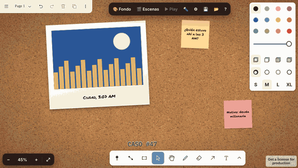
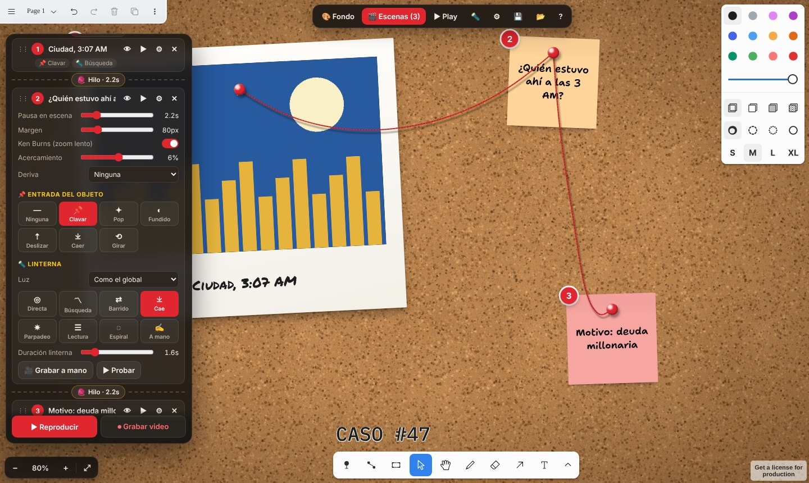
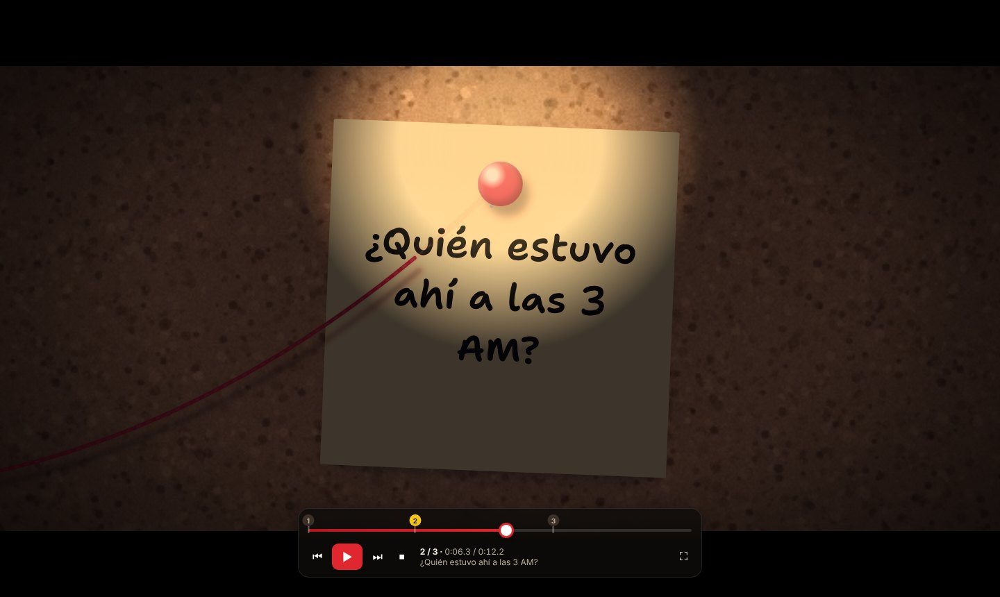

<div align="center">


# Corkboard Studio

**Un tablero de investigación tipo corcho para armar historias y convertirlas en video.**
Notas, fotos Polaroid, pines, hilos rojos… y un **Modo Reproducción** con zoom cinematográfico,
linterna de detective, barras de cine y grabación a video, pensado para videos de YouTube.

[](LICENSE)
[](https://tldraw.dev)




</div>

---

## ✨ Qué hace

### 🧷 El tablero
- **Lienzo infinito** sobre [tldraw](https://tldraw.dev): notas, texto enriquecido, flechas, dibujo, resaltador, imágenes.
- **Fondos**: corcho (cálido, rojizo, neutro, oscuro), fieltro, pizarra, papel, cuadrícula, puntos, color liso o **tu propia imagen**. Tono, escala y bordes oscuros ajustables. Las texturas se generan por código y se mueven con la cámara.
- **Pines inteligentes** (`P`): caen y **se clavan** con animación sobre la nota o la foto que tienen debajo y **la acompañan** al moverla, rotarla o agrandarla. Se agarran fácil (área de clic grande), se balancean como un péndulo y pueden llevar un cordel o una etiqueta colgando (“Evidencia A”).
- **Hilo rojo con física** (`Y`): arrastrá de un pin a otro (o de una nota/foto a otra: si no hay pin, se clava uno solo). Es un hilo de verdad: **cuelga con su peso, se balancea** cuando movés una nota y se va frenando. Se puede aflojar o tensar y elegir lana, cordel o nylon. Al aparecer se “tensa” de punta a punta.
- **Animaciones al armar el tablero**: cada nota, foto o texto nuevo se apoya en el corcho con una pequeña caída y su sombra.
- **Highlights y anotaciones solidarias**: un resaltado, un trazo o un texto que hacés encima de una nota **se mueve con ella** (arregla el bug clásico del highlight que se queda quieto).
- **Fotos Polaroid**: al pegar una imagen o una captura (`Ctrl+V`) se convierte sola en Polaroid. Doble clic para escribir el **caption** (explicar siglas, datos, contexto) con tipografía de marcador, manuscrita, máquina de escribir o moderna; tamaño, negrita, cursiva y alineación. También tiene marco fino o sin marco.
- **Zoom suave** en pasos de 20 % (configurable de 5 % a 50 %), con indicador de porcentaje y vuelta a 100 % con un clic.
- **Clic derecho + arrastrar** mueve el tablero sin cambiar de herramienta.
- **Linterna libre** (`J`): ilumina donde está el mouse, para explicar en vivo.

### 🎬 Modo Reproducción (opcional)


- **Escenas en orden**: agregás lo seleccionado, la vista actual o hacés clic en el tablero en el orden de tu historia (🎯). Las tarjetas se reordenan arrastrando.
- **Nodos de transición** entre cada escena: suave, corte, **gaussiana**, fundido, **glitch**, **barrido** (whip pan), golpe de zoom o **🧶 Seguir el hilo** (la cámara recorre el hilo rojo que une las dos pistas mientras se va desenrollando), cada una con duración, curva e intensidad. **▶ Probar** reproduce solo ese tramo.
- **Marcos de cámara** (`C`): un rectángulo amarillo que define exactamente qué se ve. Lo **movés y lo agrandás o achicás** como cualquier forma, en 16:9 (YouTube), 9:16 (Shorts/Reels), 4:3, 1:1 o libre.
- **Ken Burns**: zoom lento y deriva durante cada escena.
- **Linterna de detective** con **animaciones**:
  - *Búsqueda*: entra desde arriba y busca de forma errática hasta encontrar la hoja.
  - *Barrido*, *Cae* (con rebote), *Parpadeo* (lamparita que falla), *Lectura* (lee renglón por renglón), *Espiral*.
  - **A mano** 🎥: grabás el recorrido moviendo el mouse y se reproduce tal cual. Queda guardado relativo al objeto, así que si lo movés o agrandás el recorrido lo acompaña.
- **Entradas de objetos**: 📌 **Clavar** (la hoja baja, se apoya en el corcho y el pin se clava encima), pop, fundido, deslizar, caer, girar. Con **“Ocultar cada objeto hasta su escena”** el tablero se va armando a medida que avanza la historia.
- **Efectos**: barras de cine, viñeta, grano de película, color (noir, sepia, cálido, frío, vivo) y presets: **Detective Noir**, **YouTube Explainer**, **Polaroid Story**, **Tráiler**.
- **Barra de tiempo arrastrable** con una marca por escena: adelantás, rebobinás y repasás la cinemática cuadro por cuadro.
- **⏺ Grabar video**: recorre todo el circuito sin controles en pantalla y te da el video (MP4 o WebM) para descargar.



---

## 🚀 Empezar

### 🌐 Usarlo (localhost)
Requisito: [Node.js LTS](https://nodejs.org) (`winget install OpenJS.NodeJS.LTS`).

- **Windows:** doble clic en **`iniciar.bat`** → instala dependencias y abre `http://localhost:5173`.
- **Linux / macOS:** en una terminal, `./iniciar.sh` → instala dependencias y abre `http://localhost:5173`. (Algunos exploradores de archivos permiten doble clic → *Ejecutar*, pero no todos.)
- **Cualquier sistema:**
  ```bash
  git clone https://github.com/xXKuroiKenshiXx/corkboard-studio.git
  cd corkboard-studio
  npm install
  npm run dev
  ```

> El tablero se guarda solo (en el navegador). Con 💾 / 📂 exportás e importás un `.json` con todo: imágenes, escenas y efectos. Sirve para hacer copias o pasar un tablero a otra PC.

**Todo vive en el documento.** Fondo, escenas, transiciones y efectos se guardan en `document.meta` del store de tldraw: se persisten solos (IndexedDB), viajan en el JSON exportado y entran en el historial, así que `Ctrl+Z` también deshace cambios de escenas.

**Anclaje (pines y highlights).** Un *binding* de tldraw guarda la posición del objeto anclado en coordenadas **locales y normalizadas (0..1)** del objeto de abajo, más la rotación relativa. Cada vez que ese objeto cambia, `onAfterChangeToShape` re-proyecta lo anclado con su matriz de transformación: al mover y rotar acompaña de forma rígida, y al redimensionar escala proporcionalmente (salvo los pines, que mantienen su tamaño).

**Motor determinista.** Al dar Play se arma una línea de tiempo (`transición → pausa` por escena) con todas las cámaras precalculadas. `evaluate(t)` es una **función pura del tiempo**: cámara (zoom logarítmico con “vuelo” en saltos largos), filtros del lienzo, linterna, entradas y objetos ocultos. Por eso se puede saltar a cualquier instante desde la barra de tiempo, y la grabación sale idéntica a la vista previa. El GIF de arriba se generó cuadro por cuadro con ese mismo motor.

**Linterna animada.** Cada animación es una función `τ → {x, y, radio, intensidad}` relativa al objeto. *Búsqueda* sigue un spline Catmull-Rom por puntos al azar (con semilla fija) más temblor de mano. *A mano* reproduce el recorrido grabado escalado a la duración elegida. Durante la transición, la luz viaja desde donde terminó la escena anterior hasta el punto de partida de la animación siguiente.

**Hilo con física.** Cada hilo es una cuerda de ~22 nodos integrada con Verlet: inercia + gravedad, y varias pasadas que restauran el largo de cada tramo; las puntas se fijan a los pines mediante un *binding*. La simulación corre solo mientras algo se mueve y escribe el `path` del SVG directo, sin re-render de React. Para seleccionar se usa la curva “en reposo” (parábola equivalente a la catenaria).

**Entradas.** Se animan los **hijos** del elemento de cada shape mediante una hoja de estilos regenerada en cada frame, así no se pisa la transformación con la que tldraw posiciona las formas. El modo *revelar* usa `getShapeVisibility` de tldraw (y oculta también los hilos conectados a pines que todavía no aparecieron).

---

## 🔒 Seguridad y privacidad

- **Todo es local**: no hay servidores, cuentas ni telemetría. El tablero vive en el navegador (IndexedDB), y solo sale de ahí si vos exportás el `.json` o grabás un video.
- **Sin secretos en el repo**: no hace falta ninguna clave para usarlo en `localhost`.
- **Tableros de terceros**: al importar un `.json`, tldraw valida cada registro y el fondo personalizado solo acepta imágenes embebidas o `https:` (no se puede inyectar CSS).
- **Dependencias**: `npm audit` sin vulnerabilidades al momento de publicar. Los workflows de GitHub usan permisos mínimos.

## 📜 Licencia

- El **código de Corkboard Studio** es **[MIT](LICENSE)**: usalo, modificalo y compartilo.
- Está construido sobre el **[SDK de tldraw](https://github.com/tldraw/tldraw)**, que es *source-available* bajo la [tldraw license](https://tldraw.dev/legal/tldraw-license) y **no** es open source. Se usa gratis en desarrollo (`localhost`), que es como corre este proyecto. Publicarlo en la web o empaquetarlo como app requiere una licencia de tldraw (la hobby es gratuita para proyectos no comerciales). No se puede ocultar la marca de agua “made with tldraw”.
- Detalle de todas las dependencias en [THIRD_PARTY_NOTICES.md](THIRD_PARTY_NOTICES.md).

## 🤝 Contribuir
Issues y PRs bienvenidos. Antes de mandar un PR: `npm run typecheck && npm run build:web`.

<div align="center"><sub>Hecho por <a href="https://github.com/xXKuroiKenshiXx">Kurokenshi</a> · inspirado en los tableros de investigación de los videos de YouTube.</sub></div>
